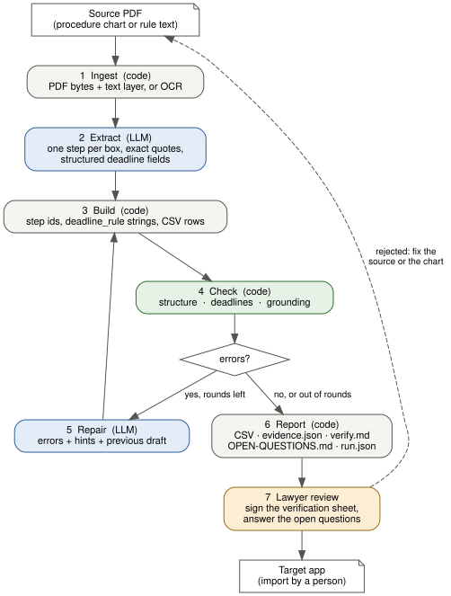

# Flowchart agent

An agentic LLM pipeline that turns a procedure document (a PDF of a court chart or
rule text) into a validated, deadline-aware flowchart, ready for a lawyer to review.

The model drafts. Code checks. A person signs off. The model never has the last word on
structure, citations or dates.



## How it works

1. **Ingest** (code). Reads the PDF: bytes for the model, embedded text or OCR for the
   checker.
2. **Extract** (LLM). Through one tool call the model fills a fixed form: one entry per
   box, the exact words printed on it, the rule as printed, where its arrows go, and for
   a time limit the event it runs from plus sign, amount and unit.
3. **Build** (code). Code, not the model, makes the step ids, the deadline rules
   (`set_down+60d`) and the CSV rows.
4. **Check** (code, no model):
   - *Structure*: one start, every step reachable, every step can reach END, no loop
     without an exit, labelled choices.
   - *Deadlines*: direction and amount agree with the chart's wording; the event counted
     from is a known date on the right side of the step.
   - *Grounding*: every step has quotes, every quote is found in the source text, and
     every rule, form and period on the step is found in its quotes.
5. **Repair** (LLM). Errors go back with the previous draft and a hint each, for a
   bounded number of rounds. The loop stops early if the same errors return.
6. **Report** (code). CSV, a verification sheet with each row beside its source text,
   the open questions, and a full trace of the run.
7. **Review** (person). Nothing is imported automatically.

Design rules: the model never computes or formats a date; nothing is accepted without a
quote from the source; doubt is flagged for a person instead of guessed.

## Status

- Checker and the full extract, check, repair, report loop: working, covered by 27
  tests that need no network or API key.
- The loop is exercised with recorded responses (`fixtures/demo`: a scripted draft with
  five seeded faults, then its correction). These are scripted, not model output.
- Evaluation of live model runs against hand-verified charts is in progress; no accuracy
  numbers are claimed yet.

The sample chart in `tests/data` is synthetic: its rule numbers are invented.

## Try it

Python 3.10+, standard library only.

```
python -m unittest discover -s tests
python -m flowagent check tests/data/sample-procedure.csv --source tests/data/sample-chart.txt
python -m flowagent extract tests/data/sample-chart.txt --prefix EXP --name sample --provider replay --replay fixtures/demo
```

The last command replays the demo and writes a run folder under `runs/`. With a key:

```
export ANTHROPIC_API_KEY=...
python -m flowagent extract chart.pdf --prefix EXP --name my-chart
python -m flowagent eval runs/<run>/my-chart.csv reference.csv
```

`eval` scores a draft against a verified chart: precision, recall and F1 for steps and
arrows, accuracy for deadline rules and citations. Optional: Poppler and Tesseract on the
PATH, so quotes can be checked against the PDF's text or OCR.

## Layout

```
flowagent/
  schema.py     the CSV format and deadline-rule grammar
  bases.json    every date a deadline may count from
  ingest.py     PDF -> bytes, text layer or OCR
  llm.py        providers: Claude (Messages API) and replay
  prompts.py    system prompt, extract and repair messages
  draft.py      the form the model fills; draft -> CSV rows
  checks/       structure.py, deadlines.py, grounding.py
  agent.py      the loop
  report.py     CSV, verification sheet, open questions, trace
  evaluate.py   score against a verified chart; diff two versions
tests/          unit tests and the synthetic sample chart
fixtures/demo   scripted responses for the replay demo
docs/CHECKS.md  every check and what it finds
```
